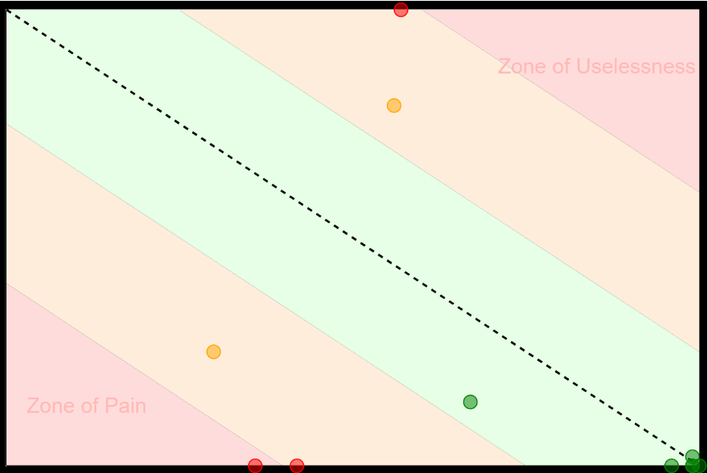

# Informe primera entrega
- Iván Casales: 257790
- Francisco Gandioli: 290071
- Matías Trujillo: 272561

## Índice
1. [Definición de marco de gestión basado en Kanban](#1-definición-de-marco-de-gestión-basado-en-kanban)
2. [Definición de un primer proceso de ingeniería](#2-definición-de-un-primer-proceso-de-ingeniería)
3. [Configuración del repositorio en GitHub](#3-configuración-del-repositorio-en-github)
4. [Análisis de deuda técnica y gestión de la calidad](#4-análisis-de-deuda-técnica-y-gestión-de-la-calidad)
5. [Definición de issues y clasificación](#5-definición-de-issues-y-clasificación)

# 1. Definición de marco de gestión basado en Kanban

**Prácticas principales**
- Swarming: reunión de emergencia cuando un integrante se encuentra bloqueado, para resolver el impedimento de forma colaborativa.
- Límite de WIP: se define un máximo de tarjetas en las columnas Doing y Testing para evitar trabajo en paralelo excesivo.
- Definition of Ready (DoR): criterios que una tarea debe cumplir para ingresar al tablero (claridad en requisitos, criterios de aceptación y dependencias resueltas).
- Definition of Done (DoD): criterios para considerar una tarea finalizada (código revisado, pruebas automáticas en verde, cobertura mayor a 90 %, documentación actualizada).
- Mejora continua: revisión periódica del flujo de trabajo en las retrospectivas, ajustando límites de WIP, columnas y métricas según aprendizajes.

**Definition of Ready (DoR)**:
- Título: Nombre breve y representativo de la tarea/issue.
- Descripción: Detalle claro del objetivo, alcance y contexto.
- Tipo: Bug, Feature, Task
- Tipo de análisis: Mantenibilidad - Funcionalidad - Seguridad (pueden seleccionarse varios si aplica).
- Prioridad: Alta - Media - Baja, según impacto y urgencia.
- Estado: To Do - Doing - Testing - Done, depende de qué columna del tablero se encuentre.

**Definition of Done**:

Una tarea o historia de usuario se considera terminada solo si cumple todos los siguientes criterios:
- Código completo y revisado
    - Implementación finalizada, revisada en Pull Request por al menos un integrante distinto del autor.
    - Estilo y estándares validados por linters y formateadores automáticos.
- Pruebas y calidad
    - Cobertura mínima del 90 % en pruebas unitarias y de integración.
    - Todas las pruebas automáticas pasan en GitHub Actions sin errores.
    - Se corrigen defectos encontrados en la fase de Testing.
- Integración continua
    - Build exitoso en la pipeline de CI/CD.
    - Merge a la rama main realizado solo tras aprobar revisiones y pasar validaciones automáticas.
- Documentación
    - Código comentado cuando es necesario.
    - Documentación técnica o de usuario actualizada (README, wiki, etc.) según corresponda.
- Trazabilidad y registro
    - Tarjeta de Kanban actualizada a “Done” con el enlace al commit/PR correspondiente.
    - Registro de horas en Clockify para la actividad.

**Medición**

Clockify para registrar y analizar el tiempo dedicado a cada tarea y obtener métricas de productividad y capacidad.

**Tablero Kanban**

Columnas: To Do, Doing, Testing y Done:

- To Do
    - Tareas ya revisadas y con Definition of Ready completo, listas para ser tomadas.
    - Aún no tienen trabajo iniciado.

- Doing
    - Trabajo en curso por uno o más integrantes.
    - Código, diseño o configuración en desarrollo activo.
    - Se registra el tiempo en Clockify y se actualiza el avance en la tarjeta.
    - Mantener límites de WIP para evitar sobrecarga.
        - WIP actual: 6. 
            - Elegimos 6 porque 3 nos pareció poco, y queríamos tener un múltiple de 3 debido a que somos 3 integrantes.

- Testing
    - La implementación terminó y está en fase de verificación.
    - Incluye pruebas unitarias, integración y validaciones de criterios de aceptación.
    - Debe cumplir con una cobertura mayor a 90 % y pasar GitHub Actions antes de avanzar.
    - Se corrigen defectos encontrados en esta etapa.

- Done
    - La tarea está finalizada y cumple con la Definition of Done.
    - Código mergeado a main sin fallas.
    - Documentación actualizada y revisada por al menos un integrante.
    - Listo para entrega o despliegue en producción según corresponda.

**Roles**
- Roles: developers, product owner, tester, Scrum master

Todos los miembros actúan como Desarrollador y Tester.

- Ivan: Developer, Tester
- Matías: Dev, Tester, Product Owner
- Francisco: Dev, Tester, Scrum Master

(Los roles de Product Owner y Scrum Master rotarán en entregas futuras)

**Ceremonias**
- Weekly: Se tomó esta decisión en base a - SCRUM y a como nos queda mejor para trabajar en la semana. Esto es principalmente debido a que integrantes del equipo trabajan, por lo que los horarios de reunión está más limitado a un dia entre semana y los finde de semana 
- Review: Reunión al finalizar la iteración en la que el equipo presenta el incremento del producto al Product Owner y demás interesados.
    - Su objetivo es validar las funcionalidades, recopilar feedback y decidir ajustes o nuevas prioridades en el backlog para el próximo ciclo.
- Retrospective: Sesión interna del equipo que se realiza después de la review para reflexionar sobre el proceso de trabajo.
    - Se analizan prácticas, comunicación y herramientas, identificando aciertos, problemas y acciones concretas de mejora para la siguiente iteración.

# 2. Definición de un primer proceso de ingeniería
A continuación vamos a definir la forma de trabajo a realizar:

**1. Control de versiones y repositorio**
- Plataforma: GitHub.
- Estrategia de branching: trunk-based con ramas cortas para cada feature o bug:
    - Ejemplo: feature/*
- Nomenclatura de commits: “tipo: descripción breve”. 
    - Tipos de ejemplo para utilizar: feat, fix, docs, refactor, test.
    - Ejemplo: feat:función agregada
- Flujo de trabajo de commits
    - Crear nueva branch a partir de main.
    - Desarrollar usando las metodologías acordadas.
    - Hacer commit siguiendo el estándar de mensajes.
    - Hacer push de la branch al repositorio remoto.
    - Abrir Pull Request a main, asegurando que la cobertura de pruebas sea mayor a 90 % y que el código sea revisado por al menos un integrante.
    - Git merge a main solo si pasan todas las GitHub Actions.
    - Repetir este ciclo.

**2. Prácticas de desarrollo**
- Revisión de código obligatoria antes de cada merge (indicando los reviewers en el pull request).
- Linters y formateadores automáticos.
- Pair programming opcional para funcionalidades críticas.

**3. Testing**
- Cobertura mínima de 90 % para permitir merges.
- Ejecución automática de tests en cada push y pull request mediante GitHub Actions.

**4. Integración continua (CI)**
- Pipeline de build + linters + pruebas. En un futuro se puede revisar y mejorar.
- Merge a main bloqueado si falla cualquier paso.

**5. Mejora continua**
- Revisión final por el PO para validación y futuras mejoras en los incrementos.
- Retroalimentación en cada retrospectiva.
- Ajustes documentados en los informes de avance.

# 3. Configuración del repositorio en GitHub
Organización repo:
- ObligD2: Obligatorio a analizar y mejorar.
- docs: Documentación nuestra (ejemplo: letra del obl de ISA2, Libro, etc)
- .gitignore
- Informes: Archivos .md con las entregas
- README.md: Readme general

Estrategia inicial de branching: Actualmente, como solo copiamos el reporte, lo organizamos y subimos documentación, únicamente utilizamos la rama main por simplicidad. Sin embargo, como se aclaró más arriba, en un futuro más a utilizar metodologías de branching como trunk based.

Estándares de nomenclatura: Más arriba se definieron los estándares de nomenclatura para los commits.

# 4. Análisis de deuda técnica y gestión de la calidad

## Definición del modelo de calidad
Usando como referencia el modelo de calidad ISO25010, seleccionamos únicamente las columnas: function suitability (que las cosas funcionen como se espera) y mantenibilidad.

### Function suitability
Elegimos function suitability porque nos importa que el sistema haga lo que tiene que hacer y cumpla con lo que piden los usuarios. Si no cubre bien las funciones, el resto no tiene sentido.

### Mantenibilidad
Elegimos la mantenibilidad porque ya lo vimos en Diseño 1 y 2, y sabemos que es clave que el código sea fácil de entender, modificar y extender sin romper todo lo demás.

### Seguridad
Elegimos la seguridad porque los integrantes del equipo se encuentran cursando la materia de seguridad informática. Si bien actualmente hemos visto principalmente contenido teórico, nos ha parecido interesante investigar por nuestra cuenta más a nivel técnico.

## Análisis de deuda técnica
### Function suitability
- **Falta de acceso cómodo a login/registro**: No hay una forma cómoda de ir a login o registro.Actualmente hay que escribir a mano el link para entrar en la página de login.

- **Ausencia de usuario administrador inicial**: Al principio la base de datos estaba vacía, por lo que no tenía usuario admin, lo cual es necesario, y la única forma de crearlo fue insertando directamente en la base de datos.

- **Búsqueda por similitud**: Cuando se buscan objetos, la búsqueda es por exactitud en lugar de similitud, lo que puede resultar incómodo para el usuario: Ejemplo si buscás “Objeto”, no se aparece “Objeto1”.
    - Si bien no es en sí un error, y corresponde más a nivel de accesibilidad, consideramos corregirlo como una funcionalidad incompleta. 

- **Error en tracking Code**: Si escribimos un tracking code inválido, la aplicación nos muestra un error, pero aún así lo agrega a la lista de tracking code en lugar de rechazarlo y no agregarlo.

- **Manejo de los mensajes de error del sistema**: El sistema del manejo de errores en algunos casos no muestra los errores reales, con mensajes genéricos. Por ejemplo, al ingresar un número mayor al integer max value sale el error: “Error Add Purchase failed: undefined”.

### Mantenibilidad
- **Mejoras respecto abstracción-estabilidad y complejidad ciclomática**: Para el siguiente análisis utilizamos la herramienta NDepend, lo cual es una herramienta de análisis estático para proyectos .NET que ayuda a medir, visualizar y mejorar la calidad del código. Resultados:

    - Mejorar relación abstracción-estabilidad de los paquetes Domain, Exceptions y InstrumentationInterface
    - Reducir complejidad ciclomática de los paquetes WebApi, Domain y BusinessLogic.
    - Mejorar el índice de mantenibilidad del paquete DataAccess

- **Codificación de caracteres**: Los acentos y la letra ñ se muestran mal (ej. “ó” → “¦ü”) en carpeta de documentación.
    - Inconsistencia en nombres: Archivos con nombres desiguales dificultan la lectura, búsqueda y gestión en sistemas de control de versiones como Git.
    - Problemas de portabilidad: Estas inconsistencias generan errores en distintos sistemas operativos y complican herramientas de lectura de docs.

- **Código repetido en manejo de errores**: 
Unificar la lógica de manejo de errores en un servicio centralizado para evitar duplicación y mejorar la mantenibilidad.

- **Falta de comentarios y documentación**: Agregar documentación básica en métodos y clases para mejorar la comprensión futura.

- **Nombres de métodos demasiado genéricos**
Renombrar métodos como handleError o log a nombres más descriptivos.

### Seguridad

- **Sin Cifrado de Contraseñas**
    - Contraseñas en texto plano: Las contraseñas se almacenan sin ningún tipo de protección.
    - Ausencia de hashing
    - Comparación insegura: Se realiza comparación directa de contraseñas (!user.Password.Equals(password)).

- **Tokens de Autenticación Inseguros**
    - Sin uso de JWT: El sistema utiliza GUIDs simples como tokens.
    - Sin expiración: No se implementa TTL (Time To Live).
    - Sin refresh tokens: No existe mecanismo de renovación de tokens.
    - Almacenamiento inseguro: Los tokens se guardan en la base de datos sin encriptación.

- **Comunicación Insegura**
    - Falta de HTTPS obligatorio: No se exige conexión segura para las comunicaciones.
    - Headers de autorización incorrectos: No se usa el prefijo Bearer.

- **Gestión de Sesiones Vulnerable**
    - Sesiones sin expiración automática: Las sesiones permanecen activas indefinidamente.

- **Falta de Validación de Entrada**
    - Riesgo de inyección: No se validan ni sanitizan los datos de entrada, lo que expone a ataques de inyección SQL u otros.

# 5. Definición de issues y clasificación
En base al tablero y a la Definition of Ready, realizamos la creación de los Issues en el proyecto del repositorio de Github y los asignamos en la columna “To do”